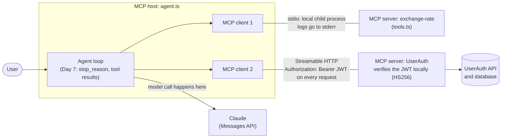

# Day 11 notes: MCP concepts

Spec version I read: **2026-07-28** (stateless). Older tutorials describe an `initialize` handshake and sessions, which this version replaces with `server/discover` and per-request metadata.

## Architecture diagram: my Day 7 agent on MCP

## 1. Mapping Day 7 onto MCP

| MCP role | In my code |
|---|---|
| Server | `tools.ts`: it exposes the tools and never calls a model |
| Client | A connection object inside `agent.ts`: one per server, it lists and calls that server's tools |
| Host | `agent.ts`: it creates one client per server, runs the loop, and **makes the model call** to the Messages API |

## 2. Tools, resources and prompts

The three primitives are independent. A user picks a prompt, the host expands it into messages, and the model sees only the result.

| Primitive | Who decides | Example from my projects |
|---|---|---|
| Tool | The model | `get_exchange_rate`: the model calls it when it needs a currency conversion |
| Resource | The application | The list of a user's saved conversations (Day 9): data the application attaches as context. It is not the history window, which stays in my chat server |
| Prompt | The user | "Summarize this conversation": a template the user picks, which structures the instruction before the model reasons |

**Design choice:** if the model should fetch the conversation list on demand ("show my conversations"), it should be a tool, not a resource. I would use a tool, because it keeps the context window small: the list is only fetched and sent when asked for, instead of being attached to every request.

## 3. Transports

- **UserAuth MCP server: Streamable HTTP.** It is a network service, can be hosted remotely and scale independently, and can stream progress or notifications.
- **stdio:** logs must go to **stderr**, because stdout carries the protocol messages.
- **Authentication on HTTP** happens on every request: the client sends `Authorization: Bearer <token>`, and the server verifies the signed JWT (HS256, algorithm pinned, access secret) locally without calling the UserAuth backend. Same as `requireAuth` on Day 9.
- **Risk:** the MCP server would hold the shared HS256 secret too, as on Day 9. The architecture page recommends OAuth for HTTP tokens.

## 4. Statelessness

- MCP statelessness means the server keeps no memory of earlier requests. Every JSON-RPC request is **self-contained**: it carries the protocol version and capabilities in `_meta`.
- **Same idea as Day 2:** the Messages API remembers nothing, so every request must carry the whole history. MCP requests carry their own context in the same way.
- **What I lose:** the client must resend the version and capability information with every request.
- **What I gain:** any request can reach any server instance, so horizontal scaling, load balancing and restarts are simple. Responses can also declare how long they may be reused: `ttlMs` (time to live in milliseconds) and `cacheScope`.
- Statelessness does not make a tool's result fixed. What it allows is caching that the server explicitly declares.

## 5. Cost of many tools

- Day 6: two tools cost about 626 input tokens. Day 7: three tools plus the system prompt cost about 957. So a tool costs roughly 150 to 300 tokens, depending on its description.
- 30 tools preloaded: about **4,500 to 9,000 tokens in every request**. Over a 5-step run that is about 22,500 to 45,000 input tokens, against the 4,785 I measured on Day 7.
- **Progressive tool discovery** (the client best practices page): instead of loading every schema upfront, the client first gives the model a small index of tool names and short descriptions, fetches a full schema only when the model needs that capability, and leaves out the rest.

### Not checked yet

- I wrote the mechanism above from my understanding. I still need to quote the sentence from the client best practices page that says it, and delete any step the page does not mention.
- Trade-off to check: discovery may add a model round trip, and each extra step resends the whole history (Day 7), so it trades fewer tool tokens per step for more steps.
- My cost range is an estimate from two measurements, not a measurement of 30 tools.
